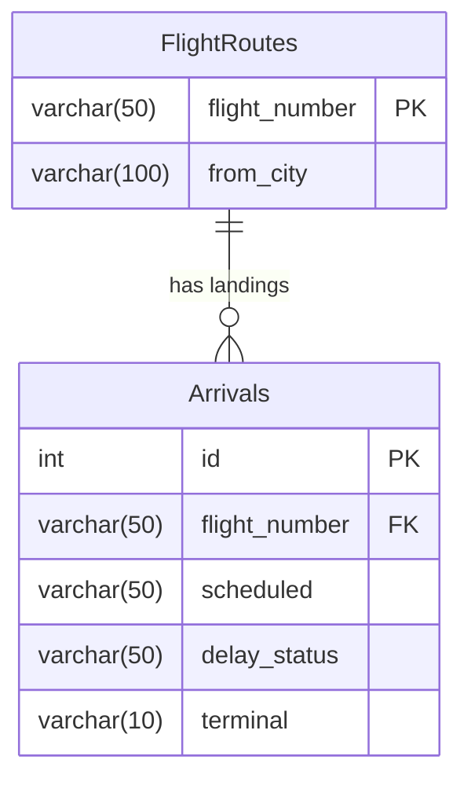

# Flight Arrivals Management System (`JDBC_FlightManager`)

**Course:** Software Engineering Methods (Academic Year 2026–2027)  
**Institution:** Braude College of Engineering | Department of Software Engineering  
**Database Engine:** MySQL 8.0+ | **Language:** Java 25 LTS (JDBC)

---

## 1. Project Description
`JDBC_FlightManager` is the **Data Access Layer (DAL)** of an airport flight-arrivals management system.
Raw landing telemetry (`arrived_flights.csv`, 299 rows) is ingested into a flat MySQL staging table (`rawflights`),
analyzed for functional dependencies, and decomposed into a **Third Normal Form (3NF)** schema of two tables
(`FlightRoutes` and `Arrivals`) linked by a Foreign Key.

On top of this schema the project provides JDBC programs that:
* display a joined live arrivals board (`FlightManagerBase` – `INNER JOIN`);
* update delay statuses in a single round-trip using a batched `PreparedStatement` (`AdvancedFlightDispatcher` – `addBatch` / `executeBatch`);
* filter and sort arrivals by terminal using a parameterized query (`FlightViewer`);
* demonstrate a live **SQL Injection** attack against a concatenated `Statement`, and its remediation into a secure,
  documented `PreparedStatement` (`SimpleFlightUpdater`).

All connections use `try-with-resources` so that `Connection`, `Statement` and `ResultSet` objects are always closed.

---

## 2. Engineering Team Details (Single-Workstation Driver–Navigator)

| Role | Full Name | Student ID | Braude Academic Email |
| :--- | :--- | :--- | :--- |
| **Student A** | Gal Florenthal | 212589469 | gal.florenthal@e.braude.ac.il |
| **Student B** | Segev Morag | 212981906 | segev.morag@e.braude.ac.il |

* **GitHub Repository URL:** https://github.com/gal2010/JDBC_FlightManager

---

## 3. Technology Stack
* **Runtime & JDK:** BellSoft Liberica Full JDK 25 LTS
* **Database Server:** MySQL Server 8.0+ (`FlightDB` schema)
* **JDBC Driver:** MySQL Connector/J 9.5.0 (`mysql-connector-j-9.5.0.jar`)
* **IDE & Database Tooling:** IntelliJ IDEA Ultimate (Built-in Database Console & SQL Generator)
* **AI Assistant:** AI coding assistant used for SQL/Java generation and security refactoring (in place of LM Studio + Continue)
* **Version Control:** Git & GitHub

---

## 4. Database Normalization (3NF) & Functional Dependencies ($F$)

### 4.1 Functional Dependencies ($F$) in `rawflights`
Relation: `rawflights(scheduled, flight, fromC, delay, terminal)`

* $\text{flight} \rightarrow \text{fromC}$ — a flight number uniquely determines its departure city (route information).
* $\{\text{flight}, \text{scheduled}\} \rightarrow \{\text{delay}, \text{terminal}\}$ — a specific landing event (a flight at a scheduled time) determines its status and arrival terminal.

Because the same flight number can land on several dates/schedules, `flight` alone is **not** a key of a landing-event row;
the landing event is identified by `{flight, scheduled}` (implemented as the surrogate key `Arrivals.id`).

### 4.2 Why `rawflights` Violated 3NF
`fromC` is determined by `flight` alone rather than by the landing event as a whole, so the departure city is repeated in
every landing row of that flight (**transitive redundancy**). This causes:
* **Update anomaly:** changing a route's departure city requires updating every landing row of that flight; missing one leaves inconsistent data.
* **Insertion anomaly:** a new route (flight → city) cannot be stored until at least one landing of that flight exists.
* **Deletion anomaly:** deleting the last landing of a flight also deletes the only record of its departure city.

### 4.3 Decomposed 3NF Relational Schema
* **`FlightRoutes`** (`flight_number` VARCHAR(50) **PK**, `from_city` VARCHAR(100) NOT NULL) — one row per route; holds $\text{flight} \rightarrow \text{fromC}$.
* **`Arrivals`** (`id` INT AUTO_INCREMENT **PK**, `flight_number` VARCHAR(50) NOT NULL **FK**, `scheduled` VARCHAR(50), `delay_status` VARCHAR(50), `terminal` VARCHAR(10)) — one row per landing event.
* **Foreign Key:** `Arrivals.flight_number` → `FlightRoutes.flight_number` `ON DELETE CASCADE`.

Every non-key attribute in each table now depends on the key, the whole key, and nothing but the key.
`scheduled` is stored as zero-padded `HH:MM:SS` text, so `ORDER BY scheduled ASC` sorts chronologically.

---

## 5. Independent AI Prompt (Part 4 – `FlightViewer.java`)

```text
Write a Java class called FlightViewer with a main method.
Ask the user for the MySQL root password with a Scanner and connect to FlightDB using DriverManager with the URL "jdbc:mysql://localhost:3306/FlightDB?allowLoadLocalInfile=true&allowPublicKeyRetrieval=true&serverTimezone=Asia/Jerusalem&useSSL=false" and the user "root".
Use try-with-resources for the Connection, the PreparedStatement and the ResultSet.
Then ask the user to enter a terminal number (2, 3, 4 or 5).
Use a PreparedStatement with a ? placeholder to select the flights from Arrivals with an INNER JOIN to FlightRoutes on flight_number, WHERE Arrivals.terminal = ?, ORDER BY Arrivals.scheduled ASC.
The terminal column is VARCHAR(10), so bind it with pstmt.setString(1, terminal).
Print the results as a formatted table (ID, flight, from city, scheduled, status, terminal) and the total number of flights at the end.
```

---

## 6. Entity Relationship Diagram (ERD)



---

## 7. Security Audit Summary (Part 5 – SQL Injection Mitigation)
* **Attack Payload Tested:** `Landed' #`
* **Vulnerability Analysis (`Statement`):** The original `SimpleFlightUpdater` built its query by concatenating user input:
  `"UPDATE Arrivals SET delay_status = '" + userInput + "' WHERE flight_number = 'LX354'"`.
  The payload produced `UPDATE Arrivals SET delay_status = 'Landed' #' WHERE flight_number = 'LX354'`.
  The single quote closed the string literal early and `#` started a MySQL single-line comment, so the `WHERE` clause was
  ignored and **all 299 rows** of `Arrivals` were overwritten with `'Landed'` (`Rows affected: 299`).
* **Remediation (`PreparedStatement`):** The class was refactored to
  `UPDATE Arrivals SET delay_status = ? WHERE flight_number = ?` with `setString(...)` bindings inside try-with-resources,
  plus full Javadoc. The SQL structure is pre-compiled by the server before any data is bound, and bound values are always
  treated as literal data, never as SQL syntax. Re-running the same payload updated **exactly 1 row** (LX354), storing the
  literal text `Landed' #`, while the other 298 flights remained intact.

---

## 8. License
Distributed under the **Braude College Academic License** (Software Engineering Methods, 2026–2027).
